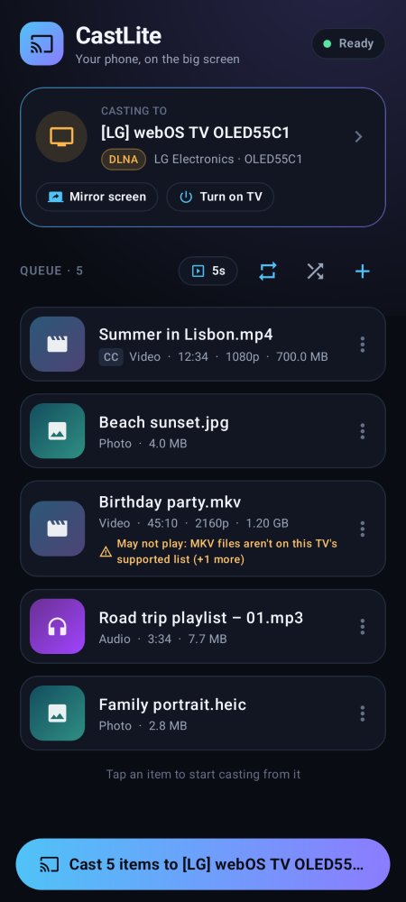
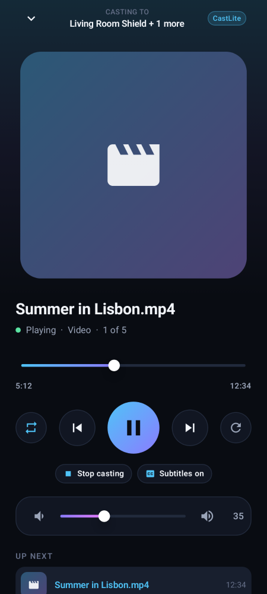
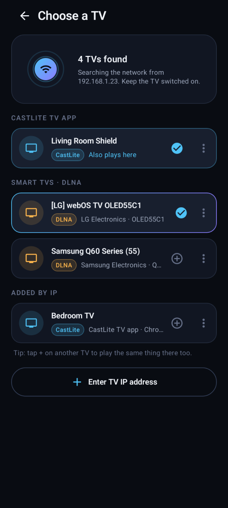
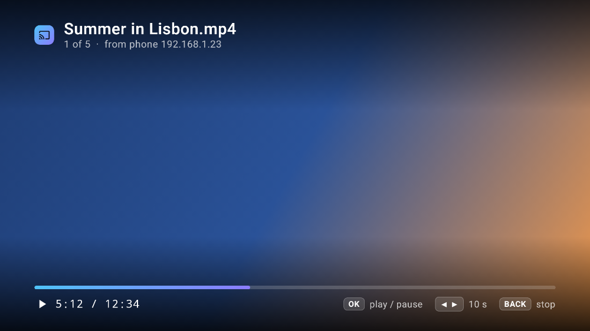
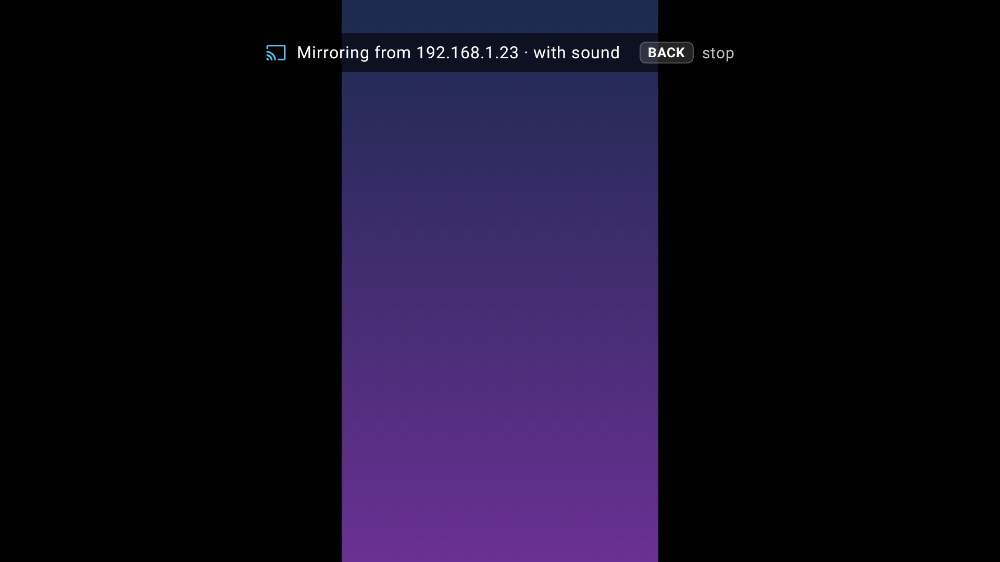

# CastLite

Send videos, photos and music from an Android phone to a TV on the same Wi-Fi —
**without Google Cast**. CastLite works with:

- **LG webOS TVs** (and Samsung, Sony, Philips, Kodi, …) through their built-in **DLNA / UPnP** renderer — nothing to install on the TV.
- **Almost any Android TV / Google TV box** through the small **CastLite TV** receiver app in this repo.

<p>




</p>
<p>


</p>
<p>


</p>

*(Screenshots are rendered from the real Compose code by the screenshot tests.)*

## Features

| | |
|---|---|
| **Add media** | System picker (many at once), **a whole folder** (sorted naturally, subtitles paired automatically), **web links** (.mp4/.mp3/.jpg or live **.m3u8**), and **Share → CastLite / Open with CastLite** from any app. The queue is saved and survives restarts. |
| **Discover** | DLNA renderers via SSDP · CastLite TV apps via mDNS/NSD · "Enter TV IP" fallback (remembered). |
| **Control** | Play / pause, seek, previous / next, jump to any item, stop, TV volume, re-send, **repeat (off / all / one)**, **shuffle**. |
| **Resume** | Long videos/songs remember where you stopped: "Continue watching? Resume at 12:34 / Start over". |
| **Will it play?** | Each file's codecs are read on the phone and compared with what the TV can decode (CastLite TV app reports its decoders; DLNA TVs list accepted formats) → "May not play: DTS audio" *before* you cast. |
| **Subtitles** | Add a `.srt`/`.vtt` to any video (or keep it next to the video in a folder). The CastLite TV app shows them (toggle from the phone or the remote's CC key); DLNA TVs get them best-effort. |
| **Slideshows** | 3/5/8/15 s per photo, crossfade/slide/zoom transitions, slow pan-and-zoom, and **music behind the photos** (CastLite TV app). |
| **Several TVs** | Tap **+** on another TV to play the same queue there too (party mode). |
| **Power on** | Wake-on-LAN: save a TV's MAC once, then **Turn on TV** — CastLite also wakes it automatically if it doesn't answer. |
| **Screen mirroring** | Show the whole phone screen (with sound on Android 10+) on the CastLite TV app, low-latency H.264, follows rotation. |
| **Anywhere controls** | Lock-screen player, notification, **Quick Settings tile**, **home-screen widget**, volume keys → TV volume. |
| **TV app** | Starts with the TV and listens in the background; **opens itself** when you cast. ExoPlayer video & audio (HLS too), photos, full remote/D-pad support. |
| **Phone locked** | Keeps casting with the screen off and resumes after Wi-Fi drops. See [below](#when-the-phone-is-locked). |
| **Diagnostics** | *Network & server → Send diagnostics*: one text file with what the phone and TV did, the TV's formats and recent errors. |
| **Auto-update** | Both apps update themselves from this repo's releases. |

## Architecture

```
┌──────────────────────────── phone (sender) ─────────────────────────────┐
│  UI (Compose)  ──►  MainViewModel / DevicesViewModel                    │
│                          │                                              │
│                          ▼                                              │
│  MediaLibrary (queue)   CastManager ── one session, readable errors     │
│        │                   │                                            │
│        │                   ▼                                            │
│        │           «CastController»  ◄── CastControllerFactory          │
│        │            ├─ DlnaController       SOAP AVTransport +          │
│        │            │                       RenderingControl, DIDL-Lite │
│        │            ├─ ReceiverCastController  HTTP JSON (protocol mod) │
│        │            └─ GoogleCastSupport    interface only (not built)  │
│        ▼                                                                │
│  MediaServerService (foreground) ─ MediaHttpServer (NanoHTTPD :8765)    │
│     GET/HEAD /media/<random-id>/<name.ext>   Range → 206, DLNA headers  │
│                                                                         │
│  DeviceRepository = DlnaDiscovery (SSDP) + ReceiverDiscovery (NSD)      │
│                     + manual IPs (AppPrefs)                             │
└─────────────────────────────────────────────────────────────────────────┘
        │ control: SOAP (DLNA)  or  JSON :8766 (CastLite)
        │ media:   TV pulls http://<phone-ip>:8765/media/…  (with Range)
        ▼
┌─────────── LG / DLNA TV ───────────┐   ┌──────── Android TV ─────────────────┐
│ built-in renderer plays the URL;   │   │ CastLite TV app                      │
│ the phone drives the queue and     │   │  ReceiverApiServer :8766 (protocol)  │
│ slideshow, polling state each sec. │   │  NsdAdvertiser  _castlite._tcp       │
└────────────────────────────────────┘   │  PlaybackEngine: ExoPlayer + queue + │
                                         │  slideshow, remote keys, errors      │
                                         └──────────────────────────────────────┘
```

The phone never pushes media bytes itself: it tells the TV *which URL to play* and
the TV downloads from the phone. HTTP Range requests let the TV jump anywhere in the
file — that's what makes seeking work.

**DLNA vs CastLite app.** A DLNA renderer only knows "the current URL", so the
`DlnaController` keeps the queue on the phone: it loads one item
(`Stop` → `SetAVTransportURI` with DIDL-Lite → `Play`), polls
`GetTransportInfo`/`GetPositionInfo` every second, and loads the next item when the
current one stops by itself (or when the photo timer fires). The CastLite TV app
receives the whole queue in one `load` command and runs it locally.

### Receiver API (phone → CastLite TV app)

Plain HTTP + JSON on port **8766**, defined once in the `protocol` module and used by both apps:

```
GET  /api/info     → {"name":"Living Room TV","model":"…","appVersion":"1.0.0","apiVersion":1}
GET  /api/status   → {"state":"PLAYING","index":0,"count":3,"positionMs":61000,"durationMs":754000,"volumePercent":40,…}
POST /api/command  ← {"action":"load","items":[{"url":"http://…","title":"…","mimeType":"video/mp4","type":"VIDEO"}],"startIndex":0,"slideDurationMs":5000}
                     {"action":"play"} {"action":"pause"} {"action":"stop"} {"action":"next"} {"action":"previous"}
                     {"action":"seek","positionMs":90000} {"action":"jump","index":2} {"action":"volume","percent":30}
                     {"action":"repeat","mode":"ALL"} {"action":"subtitles","enabled":false}
GET  /api/diagnostics → plain-text device info, decoders and the TV app's log
TCP  :8767            ← screen mirroring stream ("CLMR" header, H.264 + PCM frames; see protocol/Mirror.kt)
```

`/api/info` also reports the TV's decoders (`capabilities`), which the phone uses for
"may not play" warnings.

You can drive a TV from a laptop with `curl`, e.g.
`curl -d '{"action":"pause"}' http://192.168.1.60:8766/api/command`.

### Adding Google Cast later

`cast/googlecast/GoogleCastSupport.kt` describes the three steps: add the Cast SDK,
add a discovery source to `DeviceRepository`, and implement `CastController` with
`RemoteMediaClient`. Nothing else (server, queue, UI, notification) changes.

### Modules and code layout

```
protocol/   Pure Kotlin: receiver API models, ReceiverApiServer, ReceiverClient, mirror stream
updater/    Android library: self-update from GitHub releases (both apps)
phone/      Sender app (com.castlite.phone)
  cast/         CastController interface, CastManager, DeviceRepository, models
  cast/dlna/    Ssdp, DeviceDescription, Soap, Didl, UpnpTime, DlnaController, DlnaDiscovery
  cast/receiver/ ReceiverCastController, ReceiverDiscovery (NSD + manual probe)
  cast/googlecast/ placeholder
  media/        CastMedia, MediaLibrary (queue), MediaResolver, MimeTypes, FileNames
  server/       MediaHttpServer (Range), ByteRange, Dlna headers, MediaServerService
  net/          LanMonitor (Wi-Fi / hotspot IP, drop detection)
  ui/           Compose screens (home, devices, now playing, server), theme, components
tv/         Receiver app (com.castlite.tv)
  playback/     PlaybackEngine (ExoPlayer, queue, slideshow, keys), QueueCursor, PlaybackErrors
  net/          NsdAdvertiser
  ui/           Idle, video, audio, photo and error screens (Compose for TV)
```

`protocol` is a third, Android-free module so both apps share one definition of the
wire format and it can be tested end-to-end on the JVM.

## Getting the APKs (no Android Studio needed)

Every push to GitHub runs the tests, builds both apps (optimized release builds) and publishes a release:

**➜ [github.com/Liebe0/Castlite/releases/latest](https://github.com/Liebe0/Castlite/releases/latest)**

Download **CastLite-phone.apk** (phone) and **CastLite-TV.apk** (TV). You only do this
once — after that both apps **update themselves** (see [Automatic updates](#automatic-updates)).
Screenshots of every screen are attached to each Actions run as *CastLite-screenshots*.

### Install on the phone
Open `CastLite-phone.apk` on the phone and allow "Install unknown apps"
for your browser / file manager when asked. Android 6.0 (API 24) or newer.

### Install on an Android TV

**A. adb over the network**
1. On the TV: *Settings → Device Preferences → About* → click **Build** 7 times, then in
   *Developer options* enable **USB debugging** (and **Network debugging** if listed).
2. Find the TV's IP (*Settings → Network*, or open CastLite TV — it shows it).
3. On a computer with [platform-tools](https://developer.android.com/tools/releases/platform-tools):
   ```sh
   adb connect 192.168.1.60:5555        # accept the prompt on the TV
   adb install -r CastLite-TV.apk
   ```
   (Android 11+ TVs with *Wireless debugging* show a pairing code: `adb pair <ip>:<port>` first.)

**B. USB drive**
1. Copy `CastLite-TV.apk` to a FAT32/exFAT USB stick and plug it into the TV.
2. Install a file manager from the TV's Play Store (e.g. *File Commander*, *X-plore*),
   open the APK from the stick, and allow installing unknown apps for that file manager.

The app appears in the TV's app row as **CastLite TV**.

### LG webOS
Nothing to install. Make sure **LG Connect Apps** is on
(*Settings → General → Devices → LG Connect Apps*; older models: *Network → LG Connect Apps*)
and the TV is on the same Wi-Fi.

### Automatic updates

```
git push ─► GitHub Actions: tests ─► build (versionCode = 100 + run) ─► Release "CastLite 1.1.<run>"
                                                                        ├─ CastLite-phone.apk
                                                                        ├─ CastLite-TV.apk
                                                                        └─ update.json  (version, SHA-256, size)
phone / TV app ─► releases/latest/download/update.json ─► newer? download ─► verify SHA-256 ─► install
```

- **When they check:** at start-up, when opened, and every 6 hours while running.
- **When they install:** the phone only while the app is open and nothing is casting;
  the TV only on its idle screen — an update never interrupts playback.
- **What you'll see:**
  - *Once per device*, Android asks you to allow CastLite to install apps (phone: tap
    **Allow** on the update card; TV: press **OK** on the idle screen when it says so).
  - Android 12+ phones may then update **silently**; Android TVs and older phones show
    Android's one-tap **Update** dialog (press OK on the remote).
  - The app restarts (the TV app reopens by itself where Android allows; the phone shows
    "CastLite was updated — tap to open").
- Downloads are checked against the SHA-256 in `update.json`, and Android only accepts an
  update signed with the same key as the installed app.
- The phone's *Network & server* screen shows the installed version and a
  **Check for updates** button; the TV shows its version next to the logo.
- Releases are public because the repository is public; only the 10 newest builds are kept.
- Local (Android Studio) builds are "1.1.0-dev" and will update to the latest release.

### Signing
Debug builds are signed with `keystore/debug.keystore` (committed on purpose, password
`android`), so every CI build installs **over** the previous one. It's a debug key —
don't use it for anything you publish.

## Using it

1. Open **CastLite** on the phone → **Add media** → pick videos, photos and/or music.
2. Tap **Choose a TV** → pick your LG (DLNA badge) or Android TV (CastLite badge).
   Not listed? **Enter TV IP address** with the address shown on the CastLite TV screen.
3. Tap **Cast** (or tap any item to start from it). The now-playing screen has seek,
   play/pause, previous/next, volume and the queue.
4. On the TV remote (CastLite TV app): **OK** play/pause · **◀ ▶** seek 10 s (photos: previous/next) ·
   **CH ▲▼ / ⏭ ⏮** next/previous item · **▲▼** show info · **BACK** stop.

The status chip in the phone's top-right corner (*Ready* / *Idle* / *Offline*) opens **Network & server**: the phone's
address, the server URL (open it in any browser to test without a TV), every file URL,
and a log of what the TV requested (handy for debugging a picky TV).

## Feature notes

**TV app opens by itself.** The CastLite TV app runs a small background service that
starts when the TV boots, so the phone always finds it. When you cast, it brings itself
to the front. Android 10+ restricts apps opening on their own; if your TV refuses
(the phone then says *"Open CastLite on the TV once…"*), allow it once from a computer:

```sh
adb shell appops set com.castlite.tv SYSTEM_ALERT_WINDOW allow
```

Pressing **Home** on the TV stops video/photos; music keeps playing in the background.

**Screen mirroring** works with the CastLite TV app (choose it, then *Mirror screen*).
Android asks for permission each time. Sound needs Android 10+ and the microphone
permission (only the phone's playback is captured, never the mic); some apps (e.g.
Netflix) block capture of their picture or sound. For LG TVs, use your phone's own
*Screen Cast / Smart View* if it has one — DLNA can't mirror.

**"May not play" warnings** are hints, not blocks: TVs sometimes play more (or less)
than they report.

**Several TVs** play the same queue independently, so they can drift a little apart
on long videos; volume changes only the main TV.

**Wake-on-LAN** needs the TV's MAC address (TV settings → Network) and its "Turn on via
Wi-Fi" (LG) or "Network standby" (Android TV) option.

**Quick Settings tile / widget**: pull down Quick Settings → edit (pencil) → drag
*CastLite* in; long-press the home screen → Widgets → *CastLite*.

## When the phone is locked

Turning the phone's screen off (or locking it) doesn't stop casting:

- **Stays alive.** The media server runs in a *foreground service* (`mediaPlayback`).
  Android keeps network access and honours wake locks for foreground services even in
  Doze, so the TV keeps streaming and the DLNA queue/slideshow timers keep firing.
- **Stays awake only when needed.** A partial wake lock (+ Wi-Fi lock) is held while
  something plays or the TV is fetching data, renewed every few minutes, and released
  after 30 minutes without activity (e.g. a forgotten paused video) to save battery.
- **Control without unlocking.** A media session gives a lock-screen player
  (play/pause, previous/next, seek bar), headset buttons work, and the **phone's volume
  keys change the TV's volume**.
- **Recovers by itself.** If Wi-Fi drops or the phone gets a new IP address while it's in
  your pocket, CastLite resends the current item at the same position when Wi-Fi is
  back — no need to unlock and tap Retry. On DLNA, a TV that stops mid-video is treated
  as an interruption (not "finished"), so the queue doesn't skip ahead.
- **The TV rides out hiccups.** The CastLite TV app buffers up to 2 minutes ahead,
  retries the phone patiently, and shows "Reconnecting to your phone…" for up to about two
  minutes before giving up (photos are re-requested too).
- **Battery optimization.** On first use the app shows *"Keep casting when your phone
  locks"* → **Allow**. Some brands (Xiaomi/Redmi, Huawei, OnePlus, Samsung) add their own
  battery savers on top: set CastLite to *No restrictions / Unrestricted* and, on Xiaomi,
  enable *Autostart*. The *Network & server* screen shows whether background use is allowed.

Android 14+ no longer lets apps stop Wi-Fi power-save while the screen is off; the
connection stays up and the TV-side buffer covers the extra latency.

## Building locally

Requirements: JDK 17+ and the Android SDK (platform 35) — Android Studio covers both.

```sh
./gradlew :protocol:test :updater:testDebugUnitTest :phone:testDebugUnitTest :tv:testDebugUnitTest   # all tests
./gradlew :phone:recordPaparazziDebug :tv:recordPaparazziDebug            # re-render screenshots
./gradlew :phone:assembleDebug :tv:assembleDebug
# → phone/build/outputs/apk/debug/phone-debug.apk
# → tv/build/outputs/apk/debug/tv-debug.apk
```

### Tests (all on the JVM)

| Suite | What it covers |
|---|---|
| `RangeRequestTest`, `MediaHttpServerTest` | Range parsing; the real media server over HTTP (200/206/416, HEAD, DLNA headers, unknown sizes, missing files) |
| `DlnaPrimitivesTest` | SSDP parsing, LG-style device descriptions, SOAP envelopes/faults, DIDL-Lite, time formats, MIME normalization, XXE rejection |
| `DlnaControllerTest` | `DlnaController` against a fake UPnP renderer: load sequence, polling, seek/volume, auto-advance, interrupted vs. finished, slideshow, 701 retry, 714 errors, "TV never started", lost connection |
| `KeepAwakePolicyTest`, `PatientLoadErrorPolicyTest` | Wake-lock idle policy, auto-resume after Wi-Fi changes, TV retry/backoff policy |
| `UpdaterTest` | update.json parsing, version comparison, download through redirects, SHA-256/size verification, reuse |
| `CompatibilityTest`, `MediaLibraryPersistenceTest` | "May not play" rules, DLNA format lists, Wake-on-LAN packets, resume rules, natural sort, saved queue |
| `ProtocolV2Test`, `H264Test`, `QueuePlanTest` | New commands/fields and old-app compatibility, mirror stream framing, SPS/PPS splitting, slideshow-music planning |
| `ProtocolTest`, `ReceiverCastControllerTest` | JSON format; phone client ↔ real TV API server end to end, errors, lost connection |
| `QueueCursorTest`, `MediaLibraryTest`, `FileNamesTest` | Queue navigation, reordering, ids, host validation |
| `PhoneScreensTest`, `TvScreensTest` | Render every screen (Paparazzi) |

## Troubleshooting

- **No TVs found** — phone and TV must be on the same network, not a guest network
  ("AP / client isolation" blocks devices from seeing each other). On LG, enable *LG Connect Apps*.
- **LG says "file not supported"** — the phone shows *"didn't start … can't play this format"*.
  LG plays H.264/H.265 MP4 and MKV well; some codecs (e.g. DTS audio, AV1 on older models) aren't supported.
- **Android TV shows "This TV can't decode this file (video/hevc …)"** — the TV's hardware
  lacks that codec. Convert to H.264/AAC MP4, or try the DLNA path if the TV has one.
- **Playback stops with the phone screen off** — tap *Allow* on the "Keep casting when your
  phone locks" card (or *Network & server → Allow background use*). Xiaomi/Huawei/OnePlus
  also need *No restrictions* (and *Autostart* on Xiaomi) in their own battery settings.
- **Wi-Fi dropped** — the phone shows a red banner; when Wi-Fi is back, tap **Retry** to
  resume from where it stopped.
