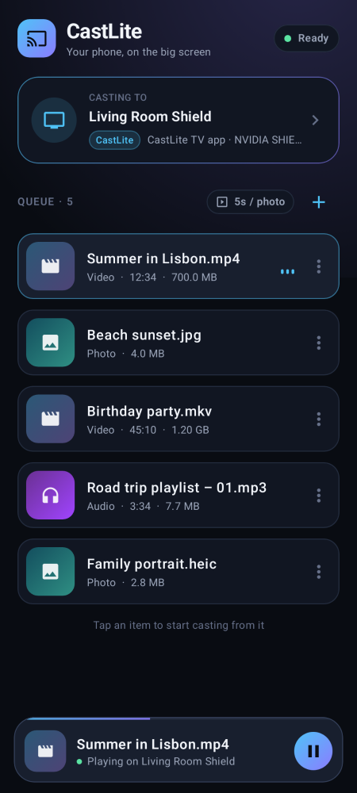
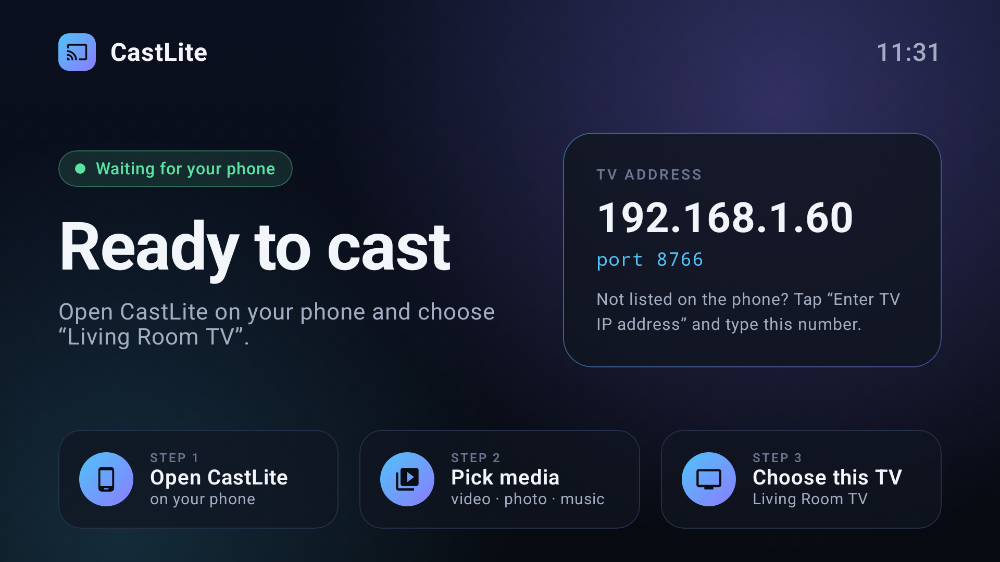
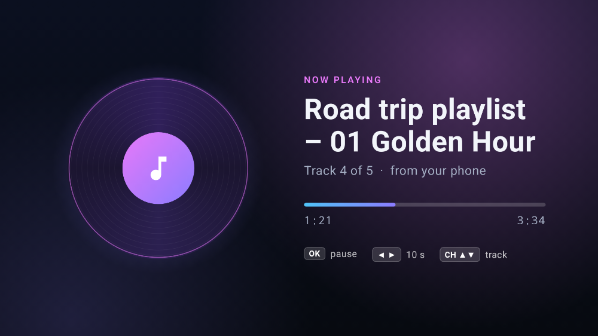
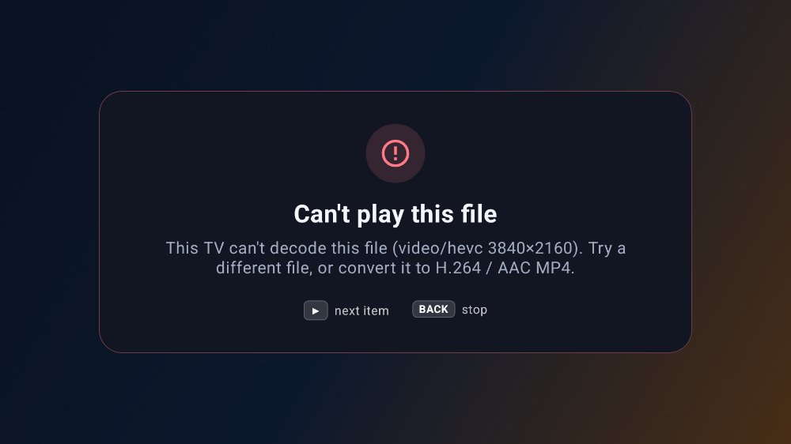

# CastLite

Send videos, photos and music from an Android phone to a TV on the same Wi-Fi —
**without Google Cast**. CastLite works with:

- **LG webOS TVs** (and Samsung, Sony, Philips, Kodi, …) through their built-in **DLNA / UPnP** renderer — nothing to install on the TV.
- **Almost any Android TV / Google TV box** through the small **CastLite TV** receiver app in this repo.

<p>



</p>
<p>


</p>
<p>


</p>

*(Screenshots are rendered from the real Compose code by the screenshot tests.)*

## Features

| | |
|---|---|
| **Pick** | System picker for video, photos and audio; pick many at once to build a queue. Thumbnails, durations, reorder, remove. |
| **Discover** | DLNA renderers via SSDP · CastLite TV apps via mDNS/NSD · "Enter TV IP" fallback (remembered). |
| **Control** | Play / pause, seek bar, previous / next, jump to any item, stop, TV volume, re-send. |
| **Queue & slideshow** | Videos and songs play one after another; photos advance every 3/5/8/15 s. |
| **Protocol shown** | Every screen shows whether DLNA or the CastLite app is in use. |
| **TV app** | ExoPlayer video & audio, photo slideshow with crossfade, full remote/D-pad support, "waiting for phone" screen with the TV's IP. |
| **Errors** | Clear messages for unsupported codecs, files the TV refuses, Wi-Fi drops, lost TVs — with *Retry*. |
| **Background** | Foreground service with notification controls (Play/Pause, Next, Stop), Wi-Fi + wake locks. |

## Architecture

```
┌──────────────────────────── phone (sender) ─────────────────────────────┐
│  UI (Compose)  ──►  MainViewModel / DevicesViewModel                    │
│                          │                                              │
│                          ▼                                              │
│  MediaLibrary (queue)   CastManager ── one session, readable errors     │
│        │                   │                                            │
│        │                   ▼                                            │
│        │           «CastController»  ◄── CastControllerFactory          │
│        │            ├─ DlnaController       SOAP AVTransport +          │
│        │            │                       RenderingControl, DIDL-Lite │
│        │            ├─ ReceiverCastController  HTTP JSON (protocol mod) │
│        │            └─ GoogleCastSupport    interface only (not built)  │
│        ▼                                                                │
│  MediaServerService (foreground) ─ MediaHttpServer (NanoHTTPD :8765)    │
│     GET/HEAD /media/<random-id>/<name.ext>   Range → 206, DLNA headers  │
│                                                                         │
│  DeviceRepository = DlnaDiscovery (SSDP) + ReceiverDiscovery (NSD)      │
│                     + manual IPs (AppPrefs)                             │
└─────────────────────────────────────────────────────────────────────────┘
        │ control: SOAP (DLNA)  or  JSON :8766 (CastLite)
        │ media:   TV pulls http://<phone-ip>:8765/media/…  (with Range)
        ▼
┌─────────── LG / DLNA TV ───────────┐   ┌──────── Android TV ─────────────────┐
│ built-in renderer plays the URL;   │   │ CastLite TV app                      │
│ the phone drives the queue and     │   │  ReceiverApiServer :8766 (protocol)  │
│ slideshow, polling state each sec. │   │  NsdAdvertiser  _castlite._tcp       │
└────────────────────────────────────┘   │  PlaybackEngine: ExoPlayer + queue + │
                                         │  slideshow, remote keys, errors      │
                                         └──────────────────────────────────────┘
```

The phone never pushes media bytes itself: it tells the TV *which URL to play* and
the TV downloads from the phone. HTTP Range requests let the TV jump anywhere in the
file — that's what makes seeking work.

**DLNA vs CastLite app.** A DLNA renderer only knows "the current URL", so the
`DlnaController` keeps the queue on the phone: it loads one item
(`Stop` → `SetAVTransportURI` with DIDL-Lite → `Play`), polls
`GetTransportInfo`/`GetPositionInfo` every second, and loads the next item when the
current one stops by itself (or when the photo timer fires). The CastLite TV app
receives the whole queue in one `load` command and runs it locally.

### Receiver API (phone → CastLite TV app)

Plain HTTP + JSON on port **8766**, defined once in the `protocol` module and used by both apps:

```
GET  /api/info     → {"name":"Living Room TV","model":"…","appVersion":"1.0.0","apiVersion":1}
GET  /api/status   → {"state":"PLAYING","index":0,"count":3,"positionMs":61000,"durationMs":754000,"volumePercent":40,…}
POST /api/command  ← {"action":"load","items":[{"url":"http://…","title":"…","mimeType":"video/mp4","type":"VIDEO"}],"startIndex":0,"slideDurationMs":5000}
                     {"action":"play"} {"action":"pause"} {"action":"stop"} {"action":"next"} {"action":"previous"}
                     {"action":"seek","positionMs":90000} {"action":"jump","index":2} {"action":"volume","percent":30}
```

You can drive a TV from a laptop with `curl`, e.g.
`curl -d '{"action":"pause"}' http://192.168.1.60:8766/api/command`.

### Adding Google Cast later

`cast/googlecast/GoogleCastSupport.kt` describes the three steps: add the Cast SDK,
add a discovery source to `DeviceRepository`, and implement `CastController` with
`RemoteMediaClient`. Nothing else (server, queue, UI, notification) changes.

### Modules and code layout

```
protocol/   Pure Kotlin: receiver API models, ReceiverApiServer, ReceiverClient
phone/      Sender app (com.castlite.phone)
  cast/         CastController interface, CastManager, DeviceRepository, models
  cast/dlna/    Ssdp, DeviceDescription, Soap, Didl, UpnpTime, DlnaController, DlnaDiscovery
  cast/receiver/ ReceiverCastController, ReceiverDiscovery (NSD + manual probe)
  cast/googlecast/ placeholder
  media/        CastMedia, MediaLibrary (queue), MediaResolver, MimeTypes, FileNames
  server/       MediaHttpServer (Range), ByteRange, Dlna headers, MediaServerService
  net/          LanMonitor (Wi-Fi / hotspot IP, drop detection)
  ui/           Compose screens (home, devices, now playing, server), theme, components
tv/         Receiver app (com.castlite.tv)
  playback/     PlaybackEngine (ExoPlayer, queue, slideshow, keys), QueueCursor, PlaybackErrors
  net/          NsdAdvertiser
  ui/           Idle, video, audio, photo and error screens (Compose for TV)
```

`protocol` is a third, Android-free module so both apps share one definition of the
wire format and it can be tested end-to-end on the JVM.

## Getting the APKs (no Android Studio needed)

Every push builds everything on GitHub Actions:

1. Open the repo on GitHub → **Actions** → **Build APKs** → the latest green run.
2. Under **Artifacts** download **CastLite-phone-debug** and **CastLite-tv-debug**
   (zips containing the APKs). **CastLite-screenshots** has renders of every screen.

### Install on the phone
Unzip, open `CastLite-phone-debug.apk` on the phone and allow "Install unknown apps"
for your browser / file manager when asked. Android 6.0 (API 24) or newer.

### Install on an Android TV

**A. adb over the network**
1. On the TV: *Settings → Device Preferences → About* → click **Build** 7 times, then in
   *Developer options* enable **USB debugging** (and **Network debugging** if listed).
2. Find the TV's IP (*Settings → Network*, or open CastLite TV — it shows it).
3. On a computer with [platform-tools](https://developer.android.com/tools/releases/platform-tools):
   ```sh
   adb connect 192.168.1.60:5555        # accept the prompt on the TV
   adb install -r CastLite-tv-debug.apk
   ```
   (Android 11+ TVs with *Wireless debugging* show a pairing code: `adb pair <ip>:<port>` first.)

**B. USB drive**
1. Copy `CastLite-tv-debug.apk` to a FAT32/exFAT USB stick and plug it into the TV.
2. Install a file manager from the TV's Play Store (e.g. *File Commander*, *X-plore*),
   open the APK from the stick, and allow installing unknown apps for that file manager.

The app appears in the TV's app row as **CastLite TV**.

### LG webOS
Nothing to install. Make sure **LG Connect Apps** is on
(*Settings → General → Devices → LG Connect Apps*; older models: *Network → LG Connect Apps*)
and the TV is on the same Wi-Fi.

### Signing
Debug builds are signed with `keystore/debug.keystore` (committed on purpose, password
`android`), so every CI build installs **over** the previous one. It's a debug key —
don't use it for anything you publish.

## Using it

1. Open **CastLite** on the phone → **Add media** → pick videos, photos and/or music.
2. Tap **Choose a TV** → pick your LG (DLNA badge) or Android TV (CastLite badge).
   Not listed? **Enter TV IP address** with the address shown on the CastLite TV screen.
3. Tap **Cast** (or tap any item to start from it). The now-playing screen has seek,
   play/pause, previous/next, volume and the queue.
4. On the TV remote (CastLite TV app): **OK** play/pause · **◀ ▶** seek 10 s (photos: previous/next) ·
   **CH ▲▼ / ⏭ ⏮** next/previous item · **▲▼** show info · **BACK** stop.

The status chip in the phone's top-right corner (*Ready* / *Idle* / *Offline*) opens **Network & server**: the phone's
address, the server URL (open it in any browser to test without a TV), every file URL,
and a log of what the TV requested (handy for debugging a picky TV).

## Building locally

Requirements: JDK 17+ and the Android SDK (platform 35) — Android Studio covers both.

```sh
./gradlew :protocol:test :phone:testDebugUnitTest :tv:testDebugUnitTest   # all tests
./gradlew :phone:recordPaparazziDebug :tv:recordPaparazziDebug            # re-render screenshots
./gradlew :phone:assembleDebug :tv:assembleDebug
# → phone/build/outputs/apk/debug/phone-debug.apk
# → tv/build/outputs/apk/debug/tv-debug.apk
```

### Tests (98, all on the JVM)

| Suite | What it covers |
|---|---|
| `RangeRequestTest`, `MediaHttpServerTest` | Range parsing; the real media server over HTTP (200/206/416, HEAD, DLNA headers, unknown sizes, missing files) |
| `DlnaPrimitivesTest` | SSDP parsing, LG-style device descriptions, SOAP envelopes/faults, DIDL-Lite, time formats, MIME normalization, XXE rejection |
| `DlnaControllerTest` | `DlnaController` against a fake UPnP renderer: load sequence, polling, seek/volume, auto-advance, slideshow, 701 retry, 714 errors, "TV never started", lost connection |
| `ProtocolTest`, `ReceiverCastControllerTest` | JSON format; phone client ↔ real TV API server end to end, errors, lost connection |
| `QueueCursorTest`, `MediaLibraryTest`, `FileNamesTest` | Queue navigation, reordering, ids, host validation |
| `PhoneScreensTest`, `TvScreensTest` | Render every screen (Paparazzi) |

## Troubleshooting

- **No TVs found** — phone and TV must be on the same network, not a guest network
  ("AP / client isolation" blocks devices from seeing each other). On LG, enable *LG Connect Apps*.
- **LG says "file not supported"** — the phone shows *"didn't start … can't play this format"*.
  LG plays H.264/H.265 MP4 and MKV well; some codecs (e.g. DTS audio, AV1 on older models) aren't supported.
- **Android TV shows "This TV can't decode this file (video/hevc …)"** — the TV's hardware
  lacks that codec. Convert to H.264/AAC MP4, or try the DLNA path if the TV has one.
- **Playback stops with the phone screen off** — some phones (Xiaomi, Huawei, Samsung)
  kill background apps aggressively: set CastLite's battery usage to *Unrestricted*.
- **Wi-Fi dropped** — the phone shows a red banner; when Wi-Fi is back, tap **Retry** to
  resume from where it stopped.
